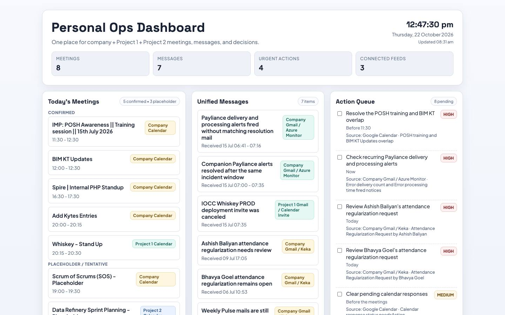
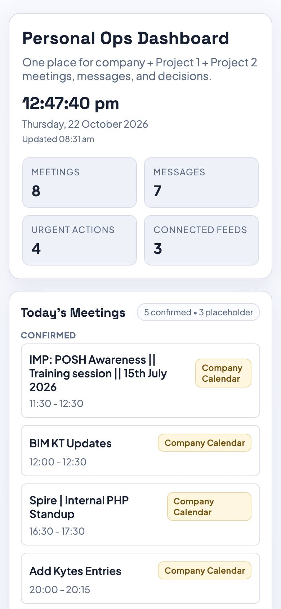

# PulseBoard

> A personal ops dashboard — meetings, messages, action items and decisions across several workstreams on one page. Plain HTML, CSS and JavaScript with data in [`dashboard-data.js`](dashboard-data.js).

<p align="center">
  
  
</p>

## Built with

HTML · CSS · JavaScript

## Run locally

```bash
python3 -m http.server 8000
# then open http://localhost:8000
```
